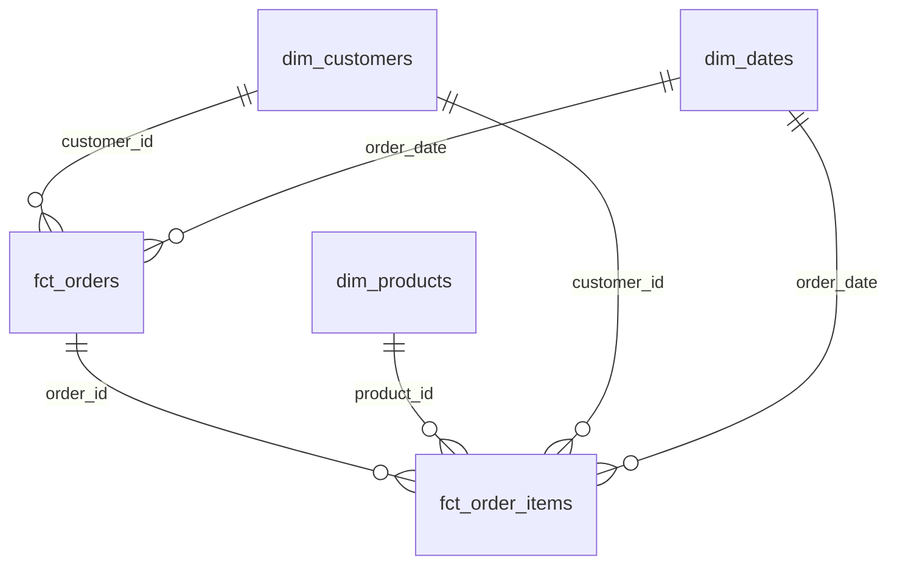
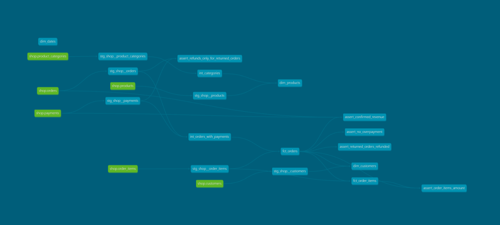

# store_hse
## Модель данных

В проекте реализована аналитическая модель интернет-магазина
по схеме «звезда».

Данные проходят три слоя:
- staging - подготовка исходных данных;
- intermediate - объединение и преобразование данных;
- marts - готовые аналитические витрины.

### ER-диаграмма

### Аналитические витрины

| Витрина | Зернистость | Бизнес-задача |
|---|---|---|
| fct_orders | Один заказ | Анализ количества заказов, выручки и среднего чека |
| fct_order_items | Один товар в заказе | Анализ продаж по товарам, брендам и категориям |
| dim_customers | Один клиент | Анализ покупателей, городов и каналов привлечения |
| dim_products | Один товар | Анализ ассортимента и иерархии категорий |
| dim_dates | Один день | Анализ продаж по датам, месяцам и кварталам |

### Хранение в Greenplum

| Витрина | Распределение | Хранение | Обоснование |
|---|---|---|---|
| fct_orders | DISTRIBUTED BY (order_id) | ao_column | Распределение по номеру заказа позволяет эффективно соединять таблицы фактов. Колоночное хранение подходит для аналитических запросов. |
| fct_order_items | DISTRIBUTED BY (order_id) | ao_column | Совпадающий ключ распределения с fct_orders уменьшает необходимость пересылки данных между сегментами при JOIN. |
| dim_customers | DISTRIBUTED REPLICATED | heap | Небольшой справочник клиентов хранится на каждом сегменте для эффективных соединений. |
| dim_products | DISTRIBUTED REPLICATED | heap | Небольшой справочник товаров реплицируется между сегментами. |
| dim_dates | DISTRIBUTED REPLICATED | heap | Небольшой календарный справочник доступен на каждом сегменте. |

### Проверки качества данных

В проекте реализованы generic-тесты:
- unique;
- not_null;
- relationships;
- accepted_values;
- non_negative.

Дополнительно реализованы четыре проверки бизнес-логики:

1. Сумма заказа совпадает с суммой его товарных позиций.
2. Сумма подтвержденных покупок совпадает с расчетом по исходным данным.
3. Для возвращенных заказов net_paid_amount = 0.
4. Сумма списаний по подтвержденному заказу не превышает стоимость заказа.

### Обнаруженная проблема

Проверка assert_no_overpayment обнаруживает двойное списание
по заказу 113.

Стоимость заказа - 200 рублей.
Две успешные операции списания - по 200 рублей каждая.
Общая сумма списаний - 400 рублей.

Исходные данные не изменяются.
Для теста установлено severity='warn'.

### Контрольные результаты

| Показатель | Значение |
|---|---:|
| Заказы без тестовых | 135 |
| Подтвержденные заказы | 106 |
| Сумма подтвержденных заказов | 91 620,00 |
| Товарные позиции | 425 |
| Клиенты | 40 |
| Покупатели | 29 |
| Клиенты без покупок | 11 |
| Товары | 13 |
| Дни календаря | 133 |

### Дополнительное задание

Для построения календарного измерения dim_dates
использован пакет dbt_utils и макрос date_spine.
### Граф зависимостей dbt

